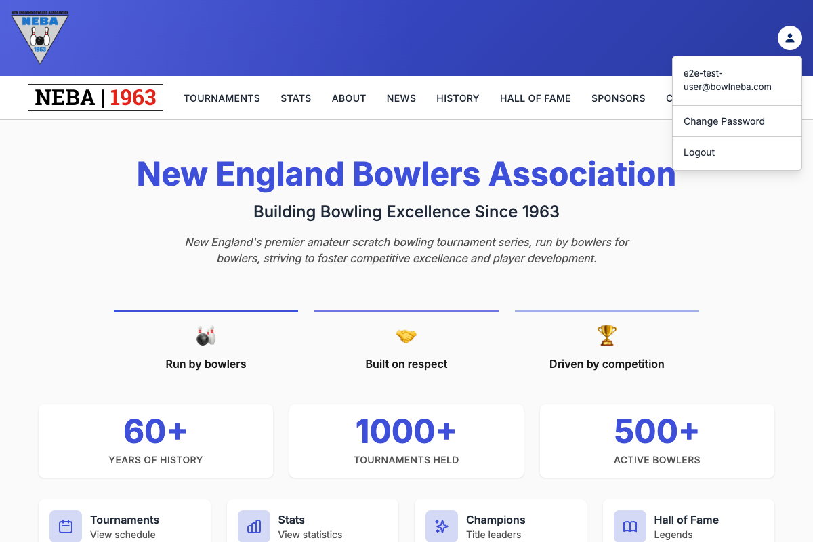
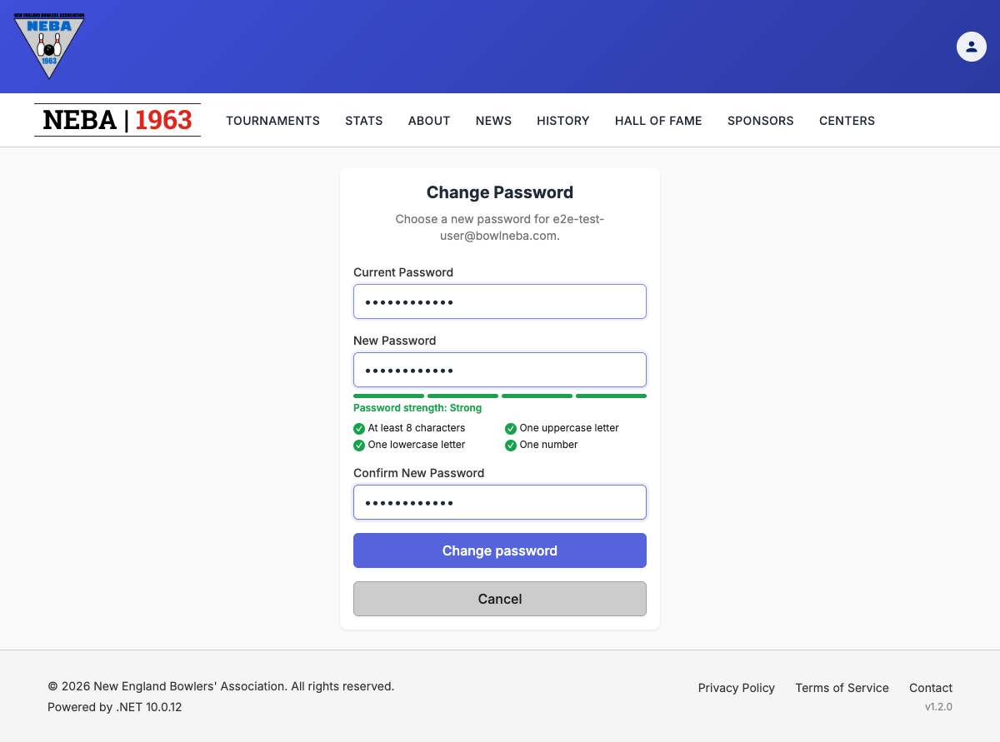
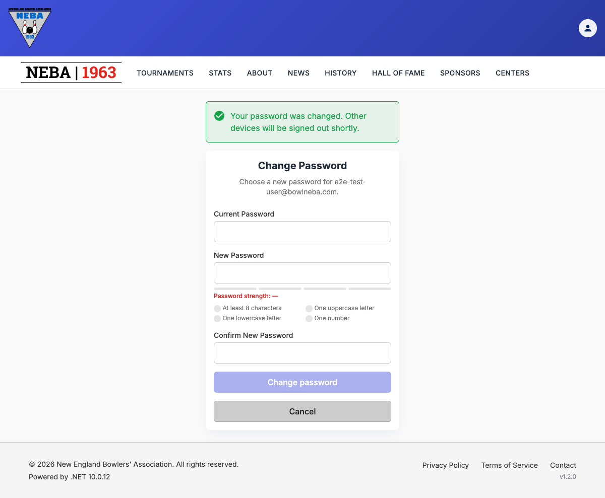
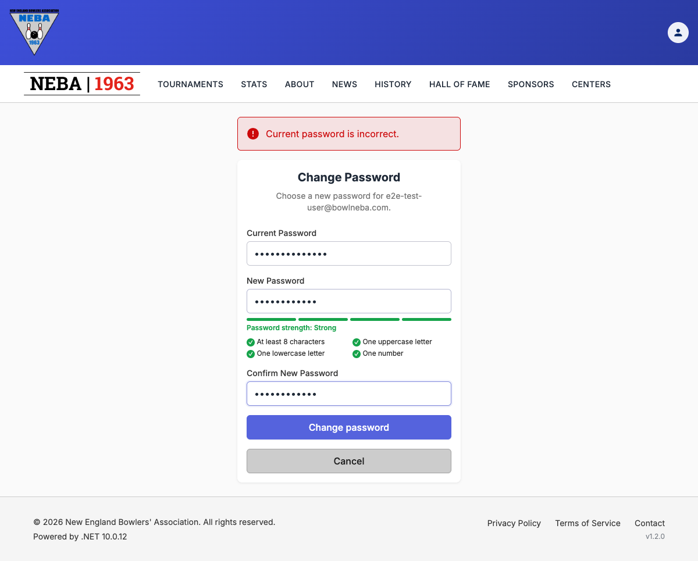

# Change Your Password

Lets a logged-in user choose a new password. You need to know your current password. If you've forgotten it, use [Reset a Forgotten Password](forgot-password.md) instead.

## Prerequisites

You need to be logged in. Every account can do this and no permission is needed. It is enforced through the `Authenticated` policy, see [`docs/policies/README.md`](../policies/README.md). You can only change your own password.

## Steps

1. Click the account icon in the top-right corner to open the account menu, then click **Change Password**.

   

2. Fill in:
   - **Current Password**: the password you use now.
   - **New Password**: a strength meter and a checklist (at least 8 characters, one uppercase letter, one lowercase letter, one number) update as you type.
   - **Confirm New Password**: the same password again.

   The **Change password** button stays off until all three are filled in, the two new passwords match, and the new password differs from the current one.

   

3. Click **Change password**.

If you've typed anything and try to leave the page before submitting, you're asked to confirm first ("Discard unsaved changes?" with **Leave**/**Stay** options, or your browser's own "leave site?" prompt for a tab close or refresh).

## What happens after you confirm

- **Success**: a message confirms "Your password was changed. Other devices will be signed out shortly." You stay logged in on this device, and the form clears.

  

- **Other devices** are signed out. They can no longer renew their session, so each one asks for a login once its current session runs out, within about 15 minutes.
- **A notice is emailed** to your account: "Your BowlNEBA password was changed". If you didn't do this, reset your password right away and contact website@bowlneba.com.
- **Session could not be refreshed**: in rare cases a warning says your password was changed but your session couldn't be refreshed. The new password works. Click **Log in again** and log in with it.

## What to know

- **Wrong guesses lock the account.** The current password is checked the same way as at login: after 5 wrong tries the account locks for 5 minutes, and even the right password is refused until the lock ends.
- **Wrong current password** shows "Current password is incorrect." and nothing changes.

  

## API

`POST /security/password/change` with a `{ "currentPassword": "...", "newPassword": "..." }` body. It needs a login (a bearer token). The account is the one in the token; the body never names a user.

- **200 OK**: the password changed. The body holds a new `accessToken`, `refreshToken`, `expiresAt`, `userId`, and `email`. Replace the stored tokens with these, because every earlier refresh token is revoked.
- **400 Bad Request**: a field is missing, the new password is under 8 characters or has no digit, or it equals the current one.
- **401 Unauthorized**: no valid login.
- **409 Conflict**: the account is locked after too many wrong current passwords. Retrying the same request works once the lock ends.
- **422 Unprocessable Entity**: the current password is wrong, or the new password breaks the password rules.

## Troubleshooting

| What you see | What it means |
| --- | --- |
| No **Change Password** item in the account menu | You aren't logged in. Log in first. |
| The **Change password** button is greyed out | A field is empty, the new passwords don't match, or the new password is the same as the current one. |
| "Current password is incorrect." | The current password was mistyped. After 5 wrong tries the account locks for 5 minutes. |
| "Too many incorrect attempts. Try again in a few minutes." | The account is locked. Wait 5 minutes, or use [Reset a Forgotten Password](forgot-password.md). |
| A message about the password rules | The new password needs at least 8 characters and one digit, plus the other items in the checklist. |
| "Your session has expired. Please log in again." | You were logged out before submitting. Log in and try again. |

## Related

- [Reset a Forgotten Password](forgot-password.md): when you can't log in.
- [Reset a User's Password](reset-password.md): the admin action for someone else's account.
- [`docs/policies/README.md`](../policies/README.md): the `Authenticated` policy this action requires.
