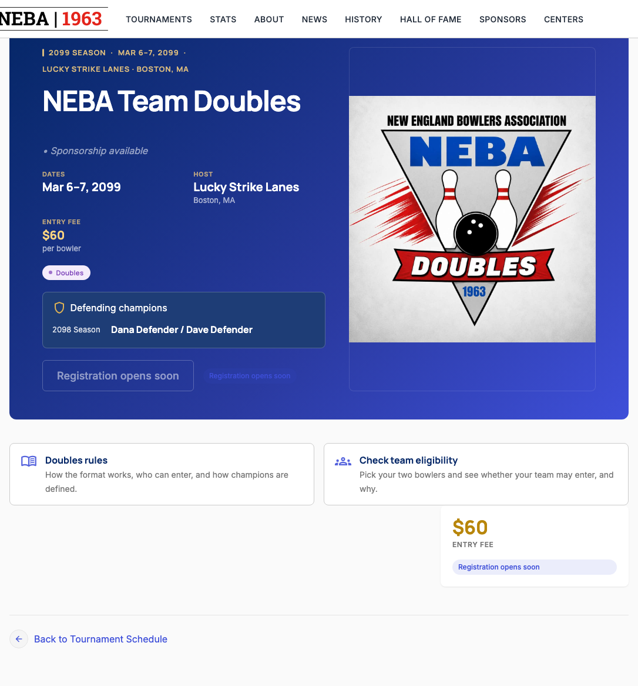
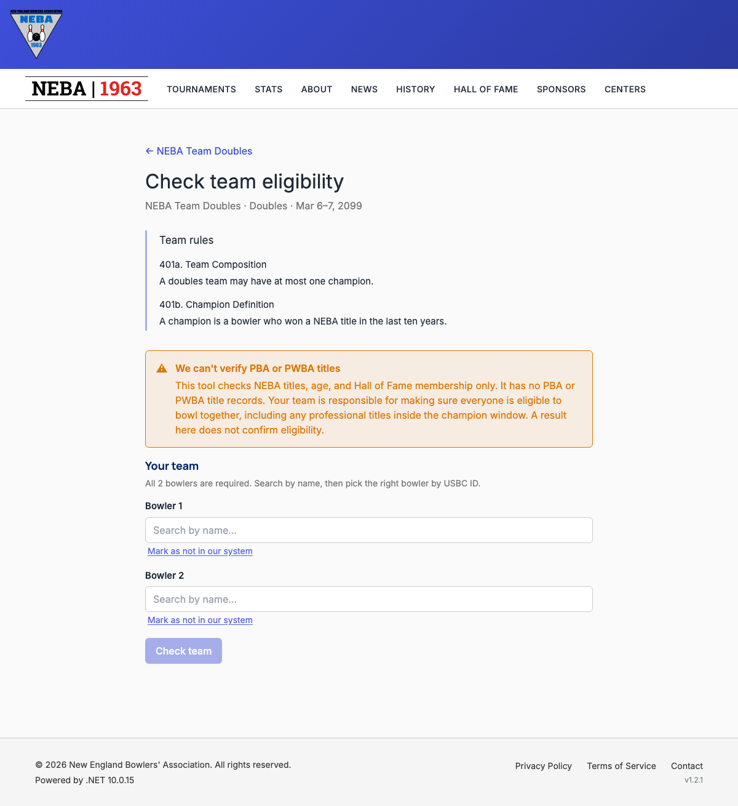
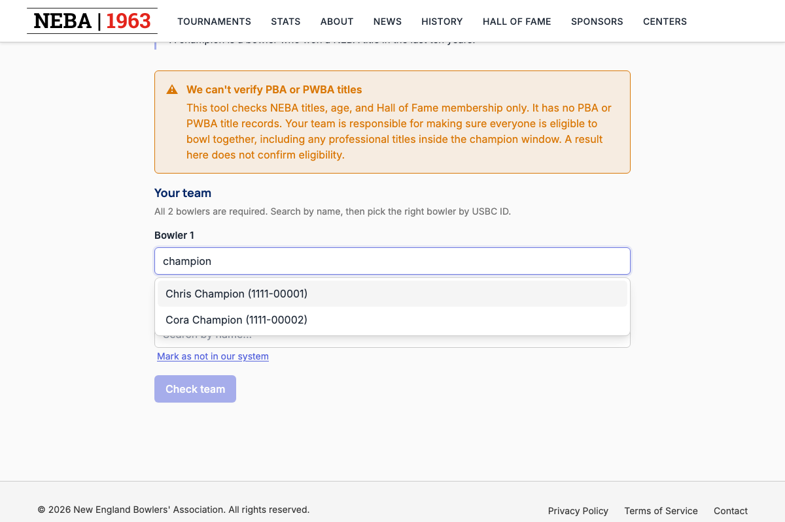
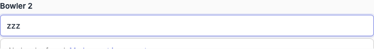
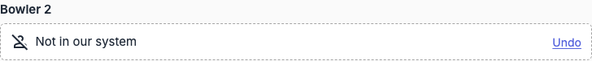
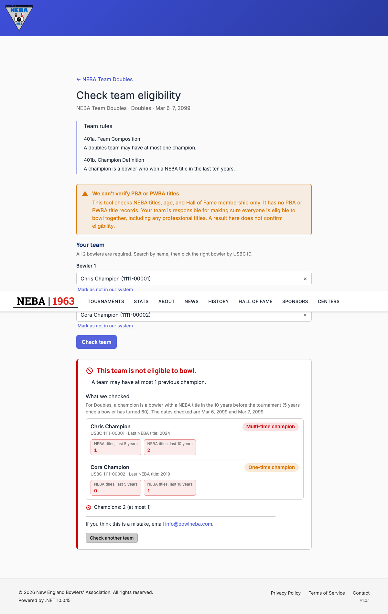
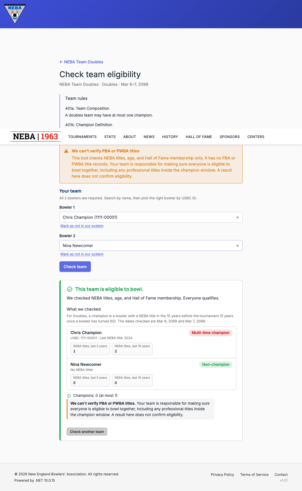

# Check Team Eligibility

Lets any bowler pick the members of a doubles, over/under doubles, trios or baker team and find out whether that team may enter a tournament under Rules 401 to 403.

## Prerequisites

None. The page is public: you do not need to sign in. It works for scheduled team tournaments; a singles tournament shows "This is not a team event".

## Steps

1. Go to the tournament's page (`/tournaments/{id}`) or its card on the Tournaments list, and click **Check team eligibility**. On the tournament page it is one of two cards under the blue banner, next to the format's rules. The link shows only for scheduled team tournaments.

   

2. Read the **Team rules** at the top of the page: the team composition rule and the champion definition for this format, taken from the NEBA rules document.

   A warning under the rules says the tool cannot verify PBA or PWBA titles and that your team is responsible for them.

   

3. Under **Your team**, fill in every bowler. Type at least three letters of a name into a picker and choose the right bowler from the list. Each entry shows the bowler's name and USBC ID, so bowlers with the same name are easy to tell apart. A bowler you already chose does not show in the other pickers.

   

4. If a bowler is not in our system, click **Mark as not in our system** under that picker (or in the "No bowler found" message). Click **Undo** to search for that bowler again.

   
   

5. Click **Check team**. The button is off until every bowler is chosen or marked.
6. Read the answer. Changing a bowler clears it. **Check another team** clears the answer and keeps your picks.

## The answers

| Answer | What it means |
| --- | --- |
| **These are the defending champions.** | The team is the previous tournament's winners (or, after a truncated tournament, the winners before it), so the champion limits do not apply. The answer names the tournament they won. A team that won more than one tournament in a row shows a gold medallion with its count, such as "2x", in the banner and on the tournament card. |
| **This team is eligible to bowl.** | The team passes the champion, Hall of Fame and age rules on every date of the tournament. |
| **This team is not eligible to bowl.** | The team breaks a rule. Each reason is listed. |
| **The answer depends on the squad date.** | The team passes on some days of the tournament and not others (for example, a bowler turns 50 during the event). Each date shows its own verdict. |

Under every answer except "defending champions", **What we checked** shows how each bowler counts: a line with the bowler's name, USBC ID and last NEBA title, and on the right whether they count as a non-champion, a one-time champion or a multi-time champion. Small cards under it show the facts that decided it:

- **NEBA titles, last 5 years**, and for doubles also **last 10 years**. Doubles shows both for every bowler, so the page never says who has turned 60 (they use the 5-year window).
- **Age we can check** (over/under only): Yes or No. It never shows a date of birth or who is over or under the age limit.
- **Hall of Fame, Superior Performance** (baker only).

A card turns red when that fact counts against a rule the team broke, and a short list under the bowlers gives each rule's tally, such as "Multi-time champions: 2 (at most 1)". A bowler marked as not in our system counts as a non-champion with no age. The counts are as of the tournament's first day.

We cannot verify PBA or PWBA titles. A notice on the page says so before you check, and a team that passes sees it again with the answer. The team is responsible for making sure everyone is eligible to bowl together, including any professional titles inside the champion window. A passing answer does not confirm eligibility.

## Troubleshooting

| What you see | What it means |
| --- | --- |
| "Type at least 3 letters to search." | The picker searches after three letters. |
| "No bowler found." | Nobody's name matches. Check the spelling, or mark the bowler as not in our system. |
| "Search is unavailable right now." | The search failed. Wait a moment and try again. |
| "We couldn't check this team. Try again, or email info@bowlneba.com." | The check failed. Try again; if it keeps failing, email NEBA. |
| An over/under team is "not eligible" because ages could not be verified | Every bowler on an over/under team must be in our system with a date of birth on file. A bowler marked as not in our system, or with no date of birth, fails this rule. If you think the date of birth is wrong or missing, email info@bowlneba.com. |
| "If you think this is a mistake" | Email info@bowlneba.com. NEBA staff can fix missing data (a date of birth or USBC ID) and you can check again. |

## Related

- [`docs/help/create-tournament.md`](create-tournament.md) and [`docs/help/edit-tournament.md`](edit-tournament.md) — where staff set a tournament's previous tournament, which supplies the defending champions.
