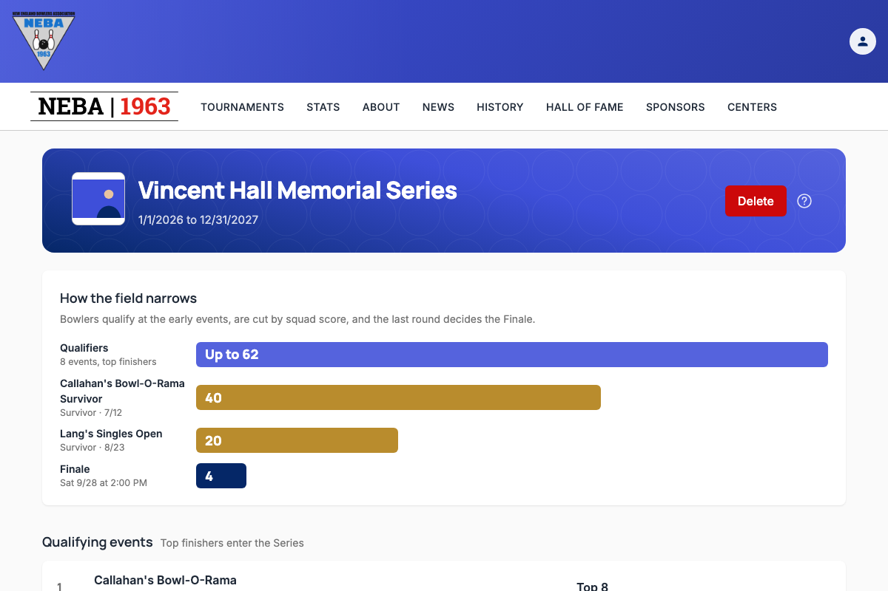
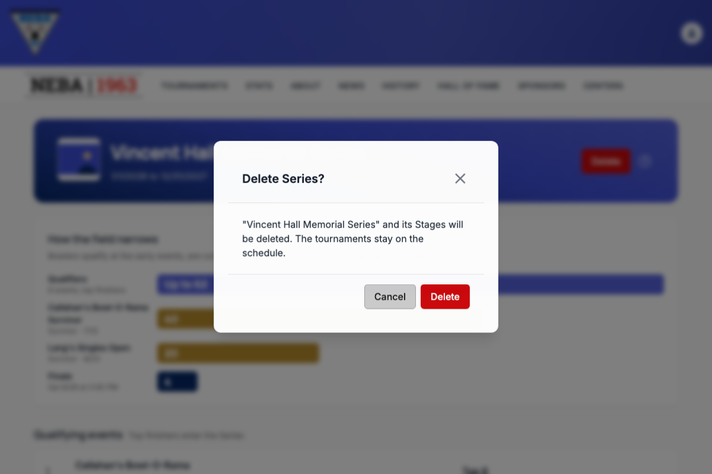

# Delete a Series

Lets staff permanently remove a Series, and its Stages, from the site.

## Prerequisites

You need the `Series.DeleteSeries` permission, enforced through the dynamic `Permission:Series.DeleteSeries` policy. See the `Permission:{value}` row in [`docs/policies/README.md`](../policies/README.md). The Admin and Manager roles hold it. If you don't have it, no **Delete** button appears on the Series page.

## Steps

1. Go to the Series' page (`/series/{id}`).
2. Click **Delete** near the top of the page.

   

3. A confirmation dialog titled **"Delete Series?"** names the Series and warns that its Stages are removed too. Deleting is not reversible.
   

4. Click **Delete** to confirm, or **Cancel** to leave the Series untouched.

Deleting a Series does not delete its tournaments. They stay on the schedule and become free to use in another Series.

## A locked Series cannot be deleted

Once any Stage of a Series has been processed, the Series is locked. On a locked Series the **Delete** button is greyed out and the reason is shown beside it. Remove the Series only before processing begins.

## What happens after you confirm

- **Success**: a "Series Deleted" message appears and you return to the Series list. The Series' logo file is removed from storage shortly afterward.
- **Already gone**: if someone else deleted it first, the delete still reports success.
- **Failure**: a "Delete Failed" message explains the problem and the Series stays.

## Troubleshooting

| What you see | What it means |
| --- | --- |
| No **Delete** button | You don't hold `Series.DeleteSeries`. Ask an admin to grant it. |
| **Delete** is greyed out with a reason | The Series is locked because processing has begun. |
| "Delete Failed" with "This Series is locked because processing has begun." | The Series locked after you opened the page. Reload it. |

## Related

- [`docs/help/edit-series.md`](edit-series.md): change a Series instead of removing it.
- [`docs/help/delete-tournament.md`](delete-tournament.md): a tournament that is a Series Stage cannot be deleted until it is removed from its Series.
- [`docs/policies/README.md`](../policies/README.md): the `Series.DeleteSeries` policy.
