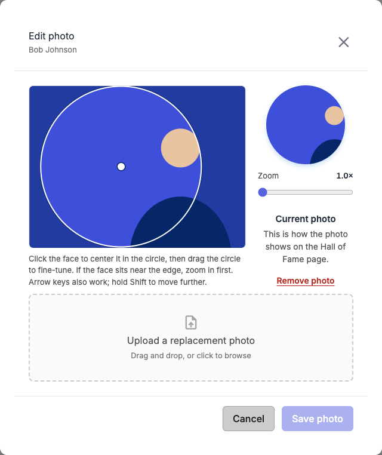
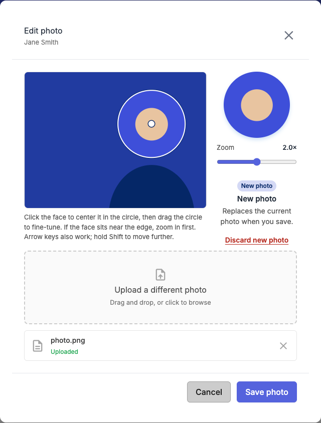

# Add or Edit a Hall of Fame Inductee's Photo

Lets staff upload, replace, align, or remove the photo shown in an inductee's round avatar on the Hall of Fame page. Without a photo the page shows the inductee's initials.

## Prerequisites

You need the `HallOfFame.EditHallOfFamePhoto` permission. It is held by the Admin, Webmaster, Manager, and Journalist roles. An admin can also grant it to a single user through that user's permission overrides. If you lack the permission, no edit button appears on the Hall of Fame page.

You can only change an inductee's photo. Inductions themselves (who, which year, which category) come from the weekly sync from the NEBA software, and that sync never changes a photo you set here.

## Steps

1. Open the **Hall of Fame** page (`/hall-of-fame`). A help button (**?**) under the page title opens this guide.
2. Click the small pencil button on the inductee's round photo.

   

3. The **Edit photo** window opens with the inductee's name. If the inductee has no photo yet, it says so, and the page shows their initials.

   

4. Do one of:
   - **Add or replace the photo.** Drag an image onto the upload area, or click to browse (one image, up to 5 MB; JPEG, PNG, WebP, or GIF). The site shrinks large photos to 1600 pixels on the longest side and removes camera data such as location, so a saved photo can be smaller than the file you chose. An animated GIF keeps only its first frame. The photo appears in the editor and is marked **New photo**. Choose **Discard new photo** to go back to the current one.
   - **Align the photo** (see below).
   - **Remove it.** Click **Remove photo**. The page then shows the inductee's initials.

   

5. Click **Save photo**. The window closes and a "Photo Saved" message appears. The page shows the change right away.

**Cancel**, **Escape**, or a click outside the window closes it. If you have an unsaved change, you're asked to confirm first ("Discard unsaved changes?").

## Aligning the photo

The page shows the photo in a circle, so part of it is cut off. The editor shows the whole photo with a ring that marks exactly what the circle will show, and a small round preview beside it.

- **Click the face.** The ring moves so the face is in the middle of the circle, as near as the photo allows. The ring cannot leave the photo, so a face close to the edge cannot be fully centered.
- **Drag the ring** to fine-tune. Press on the ring and move it; it follows where you grabbed it.
- **Zoom.** Use the **Zoom** slider (1.0× to 3.0×) to move in closer. Zooming also lets you center a face that sits near the edge of the photo, because the ring gets smaller. Zooming keeps whatever is in the ring in place.
- **Keyboard.** Click the photo area so it has focus, then use the arrow keys to nudge the ring. Hold **Shift** to move further.

The original file is never cropped or changed; the page only chooses which part to show. If you save a new photo without touching the ring, the photo is centered with no zoom.

## What happens after you save

- **It worked.** The window closes, a "Photo Saved" message appears, and the page reloads the inductee list so the avatar shows the new photo at the framing you chose. A replaced or removed photo's old file is deleted in the background.
- **It did not work.** The window stays open with a "Couldn't Save Photo" message that says why. Nothing was changed, so you can fix the issue and save again.
- **You walked away without saving.** A photo you uploaded but never saved is cleaned up automatically later; it never shows on the page.

## Troubleshooting

| What you see | What it means |
| --- | --- |
| No edit button on the Hall of Fame page | You do not hold `HallOfFame.EditHallOfFamePhoto`. Ask an admin to grant it. |
| **Save photo** is greyed out | Nothing has changed yet, or an upload is still running. |
| The ring will not move up or down (or left or right) | The photo already fits the circle in that direction. Zoom in to get room to move. |
| A red status next to the upload (e.g. "File exceeds the maximum allowed size of 5 MB.") | The file did not upload. Try a smaller or different image. |
| "The file could not be read as an image." or "The image must be no more than 12000 pixels on a side." | The file is damaged, is not really an image, or is far too large in pixels. Export it again as a JPEG or PNG and retry. |
| "Couldn't Save Photo" with a message | The server did not save the change; the message says why. The photo is unchanged — fix the issue and save again. |
| "Hall of Fame induction was not found." | The induction no longer exists. Reload the Hall of Fame page. |
| "The induction has no photo to position." | Someone removed the photo while you were editing. Close the window, reload the page, and start again. |
| "Photo must be a file uploaded through the photo upload endpoint." | The uploaded file is no longer waiting to be saved (for example, the window sat open for a long time). Upload the photo again. |

## Related

- [`docs/help/edit-tournament-logo.md`](edit-tournament-logo.md) — the tournament logo editor this one is modeled on.
- [`docs/policies/README.md`](../policies/README.md) — the `HallOfFame.EditHallOfFamePhoto` policy.
