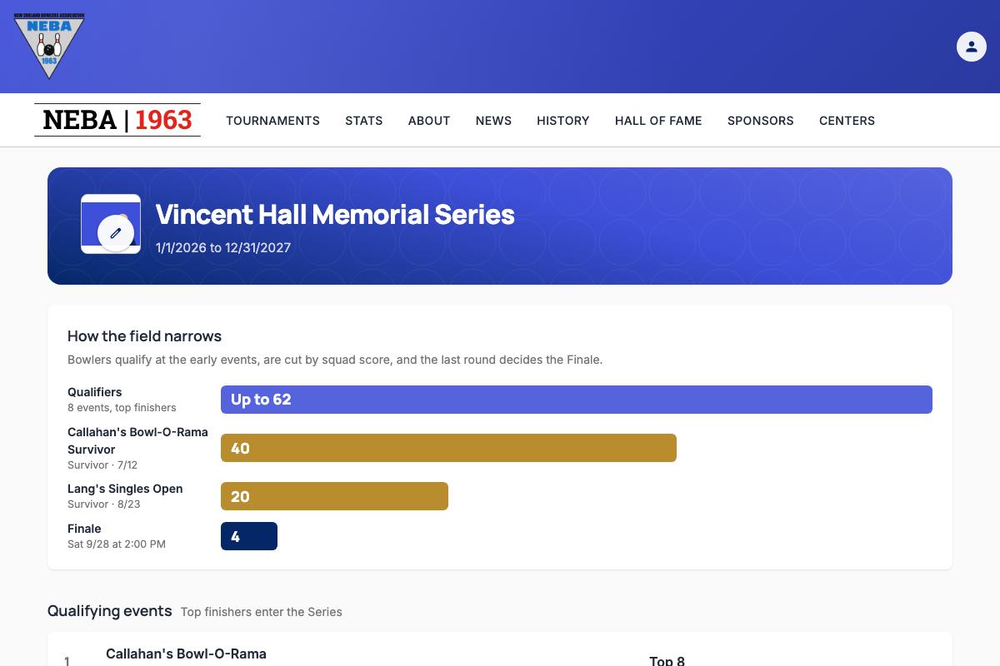
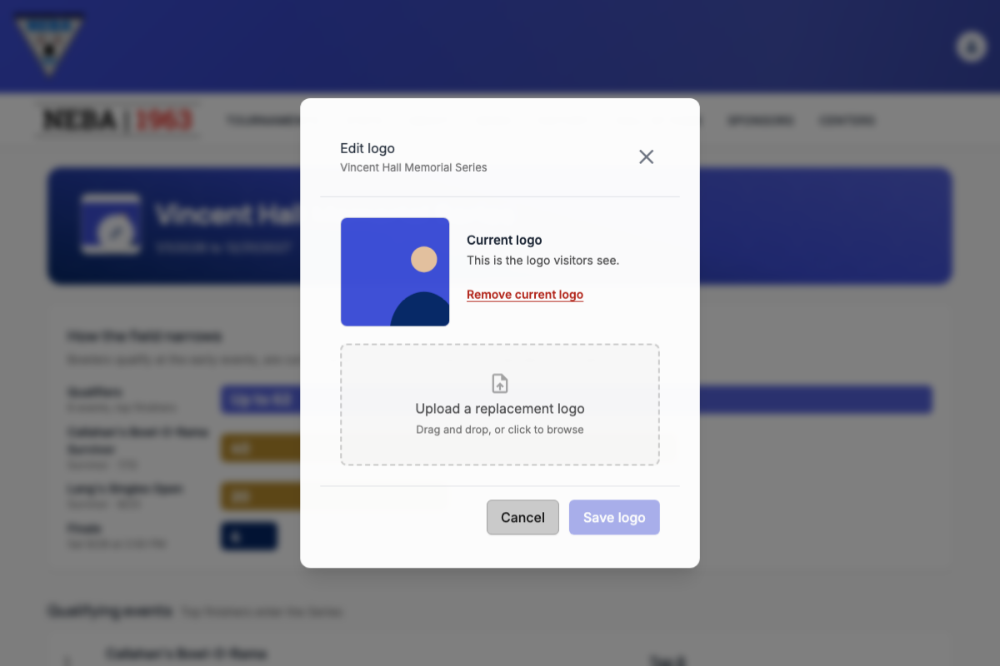

# Edit a Series' Logo

Lets staff replace or remove a Series' logo without being able to change anything else about the Series.

## Prerequisites

You need the `Series.EditSeriesLogo` permission, enforced through the dynamic `Permission:Series.EditSeriesLogo` policy. See the `Permission:{value}` row in [`docs/policies/README.md`](../policies/README.md). `Series.EditSeries` alone is not enough, so an admin can deny logo changes to a user who can still edit the rest of a Series. The Admin and Manager roles hold `Series.EditSeriesLogo`. An admin can also grant it to one user through that user's permission overrides.

Staging the file also works for anyone who can create or edit a Series, because the same upload serves the full forms. The file only attaches to a Series when the change is saved.

If you lack the permission, no edit-logo button appears. The full edit form behaves differently: see [`edit-series.md`](edit-series.md).

## Steps

1. Go to the Series' page (`/series/{id}`). The **Edit logo** button sits on the logo at the top of the page.

   

2. Click it. The **Edit logo** window opens with the Series' name and its current logo, or its initials if it has none.

   

3. Do one of:
   - **Replace it.** Drag an image onto the upload area, or click to browse (one image, up to 5 MB, JPEG, PNG, WebP or GIF). The preview switches to the new logo and is marked **New logo**. Choose **Discard new logo** to go back to the current one.
   - **Remove it.** Click **Remove current logo**. The Series then shows its initials. A Series has no sponsor fallback.
4. Click **Save logo**. The window closes and a "Logo Saved" message appears. The page shows the change right away, and so do the Series tags on the tournament pages.

**Cancel**, **Escape**, or a click outside the window closes it. If you have an unsaved change, you are asked to confirm first ("Discard unsaved changes?").

The logo is presentation only, so you can change it on a **locked** Series, one whose tournaments have begun processing.

## Troubleshooting

| What you see | What it means |
| --- | --- |
| No edit-logo button | You don't hold `Series.EditSeriesLogo`. Ask an admin to grant it. |
| **Save logo** is greyed out | Nothing has changed yet, or an upload is still running. |
| A red status next to the upload (for example "File exceeds the maximum allowed size of 5 MB.") | The file did not upload. Try a smaller or different image. |
| "Couldn't Save Logo" with a message | The server did not save the change, and the logo is unchanged. The message says why; fix it and save again. |
| "The logo is not a file uploaded through the logo upload endpoint." | The staged file expired or was never uploaded. Upload it again. |
| "This Series could not be found." | Someone deleted the Series. Return to the Series list. |

## Related

- [`docs/help/edit-series.md`](edit-series.md): the full edit, which also covers the logo.
- [`docs/help/edit-tournament-logo.md`](edit-tournament-logo.md): the same flow for tournaments.
- [`docs/policies/README.md`](../policies/README.md): the `CanUploadSeriesLogo` policy.
