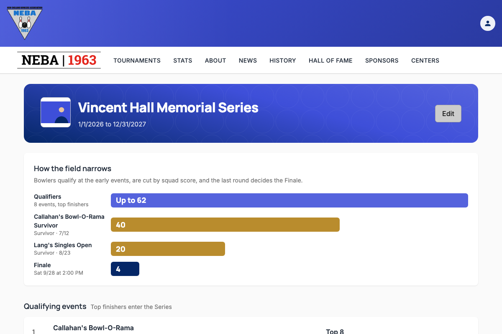
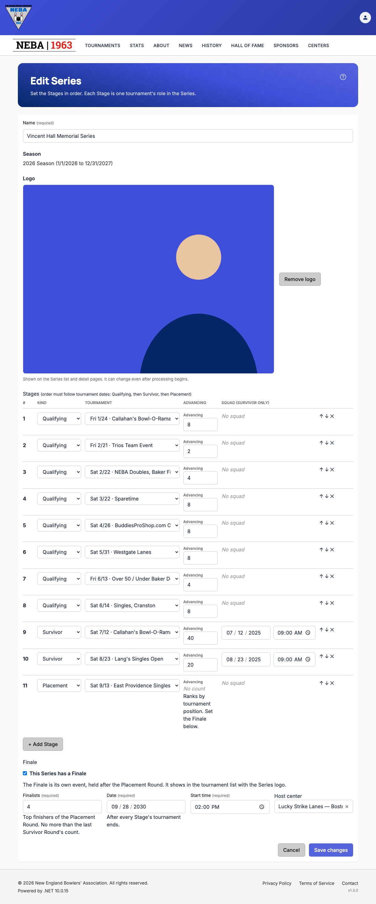

# Edit a Series

Lets staff change a Series' name, logo, Stages and Finale.

## Prerequisites

You need the `Series.EditSeries` permission, enforced through the dynamic `Permission:Series.EditSeries` policy. See the `Permission:{value}` row in [`docs/policies/README.md`](../policies/README.md). The Admin, Webmaster and Manager roles hold it. If you don't have it, no **Edit** button appears on the Series page.

Changing the logo through this form also needs the logo permission to be intact. If an admin has denied `Series.EditSeriesLogo` to your account, the form shows the logo read only, other changes still save, and the server refuses a logo change. A role that simply lacks the permission is not a denial: you can still change the logo here, because the logo is part of the Series.

## Steps

1. Go to the Series' page (`/series/{id}`) and click **Edit**.

   

2. The form opens filled in with the current values. Change what you need. The fields work as they do when you create a Series (see [`create-series.md`](create-series.md)), with one difference: **Season** is shown but cannot be changed.
   

3. Click **Save changes** to save, or **Cancel** to leave the Series as it was.

The whole Series saves at once: the name, the logo, the full list of Stages and the Finale. If any rule is broken, nothing is saved and each message appears next to the row or field it names.

## A locked Series

A Series locks as soon as any of its Stages has been processed. A locked Series shows a banner at the top of the form and a read-only Stage grid.

While a Series is locked you can still:

- change the **name**;
- change or remove the **logo**;
- change the Finale's **date**, **start time** and **host center**, because a Finale can be rescheduled.

You cannot add, remove, reorder or change Stages, turn the Finale on or off, or change its finalist count. A save that tries to returns "This Series is locked because processing has begun."

## Troubleshooting

| What you see | What it means |
| --- | --- |
| No **Edit** button | You don't hold `Series.EditSeries`. Ask an admin to grant it. |
| A "locked" banner and a read-only grid | Processing has begun for this Series. Only the name, logo and the Finale's date, time and center can change. |
| "Stage 4 (Callahan's Bowl-O-Rama): this tournament is already a Stage in the 2026 Series." | That tournament belongs to another Series. Remove the row or pick another tournament. |
| "this Stage no longer exists. Reload the Series and try again." | Someone else removed that Stage while you were editing. Reload the page and redo your change. |
| The logo is read only | An admin has denied `Series.EditSeriesLogo` to your account. |
| "This Series could not be found." | Someone deleted it. Return to the Series list. |

The last save wins. If two people edit the same Series, the later save replaces the earlier one.

## Related

- [`docs/help/create-series.md`](create-series.md): how each field works.
- [`docs/help/edit-series-logo.md`](edit-series-logo.md): change only the logo, without edit rights to the rest.
- [`docs/help/delete-series.md`](delete-series.md): remove a Series.
- [`docs/policies/README.md`](../policies/README.md): the `Series.EditSeries` policy and the logo denial.
