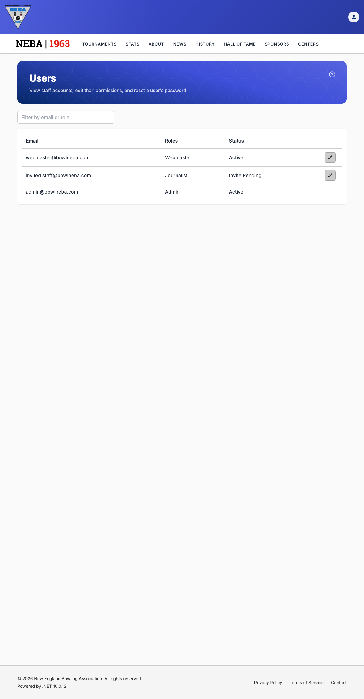
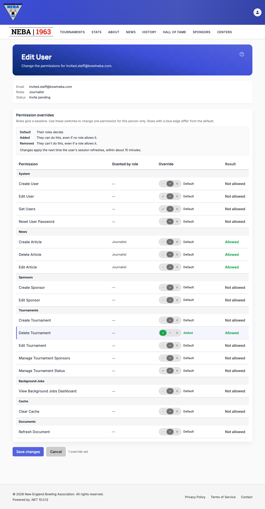

# Edit a User's Permissions

Lets an admin add or remove individual permissions for one staff member, on top of what their roles give. Each permission has three settings: **Default** (their roles decide), **Added** (always allowed), and **Removed** (never allowed, even if a role allows it).

## Prerequisites

You need the `System.EditUser` permission, enforced via the dynamic `Permission:System.EditUser` policy — see the `Permission:{value}` row in [`docs/policies/README.md`](../policies/README.md). If you don't have it, no edit icon appears on the Users page, and `/account/users/{userId}/edit` shows a "you don't have permission" message instead of the form.

You can only give someone a permission you hold yourself. Permissions you don't hold can still be set to **Removed**, but **Added** is disabled for them.

## Steps

1. Open the **Users** page (see [View Users](list-users.md)) and click the pencil icon on the user's row. Admin accounts have no edit icon.

   

2. The **Edit User** page shows the user's email, roles, and status, then a table of every permission:
   - **Granted by role** — the user's roles that allow the permission.
   - **Override** — the three-way switch: **Added** (left, green check), **Default** (middle, gray dash), **Removed** (right, red cross).
   - **Result** — whether the user can do this after your change, **Allowed** or **Not allowed**.

   Rows you've changed from Default get a blue edge.

   

3. Set the switches you want to change, then click **Save changes**. Click **Cancel** to leave without saving.

   If you've changed anything and try to leave the page before saving, you're asked to confirm first ("Discard unsaved changes?" with **Leave**/**Stay**, or your browser's own prompt for a tab close or refresh).

## What happens after you save

- **Success**: a "User Updated" toast confirms the change and you return to the Users page. The change takes effect the next time the user's session refreshes, within about 15 minutes. They don't need to sign in again.
- **Failure**: an "Unable to Save User" message explains what went wrong, and the form keeps your changes so you can fix it and try again.

## Special cases

- **Admin accounts** have every permission, so overrides don't apply. The page shows a short note and no switches.
- **Your own account** is read-only. Ask another admin to change your permissions.
- Roles, email, and other details can't be changed from this page.

## Troubleshooting

| What you see | What it means |
| --- | --- |
| No edit icon on the Users page, or a "you don't have permission" message on the edit page | You don't hold `System.EditUser` — ask an admin to grant it if you believe you should have it. |
| "This user could not be found." | The user no longer exists. Return to the Users page and refresh. |
| **Added** is greyed out on a permission | You don't hold that permission, so you can't give it to someone else. |
| "You can't change your own permission overrides." | You opened your own account. Ask another admin. |
| "Admins have every permission, so permission overrides don't apply to them." | The user holds the Admin role. Overrides can't be set on Admin accounts. |
| "Unable to Save User" with another message | The server rejected the change; the message describes the problem. Nothing was saved. |

## Related

- [View Users](list-users.md) — where the edit icon lives.
- [Create a User](create-user.md) — set overrides when you first invite someone.
- [`docs/policies/README.md`](../policies/README.md) — the `Permission:{value}` policy this action requires and how it's evaluated.
