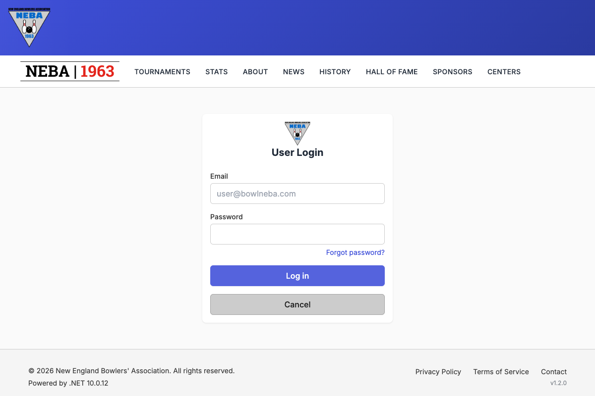
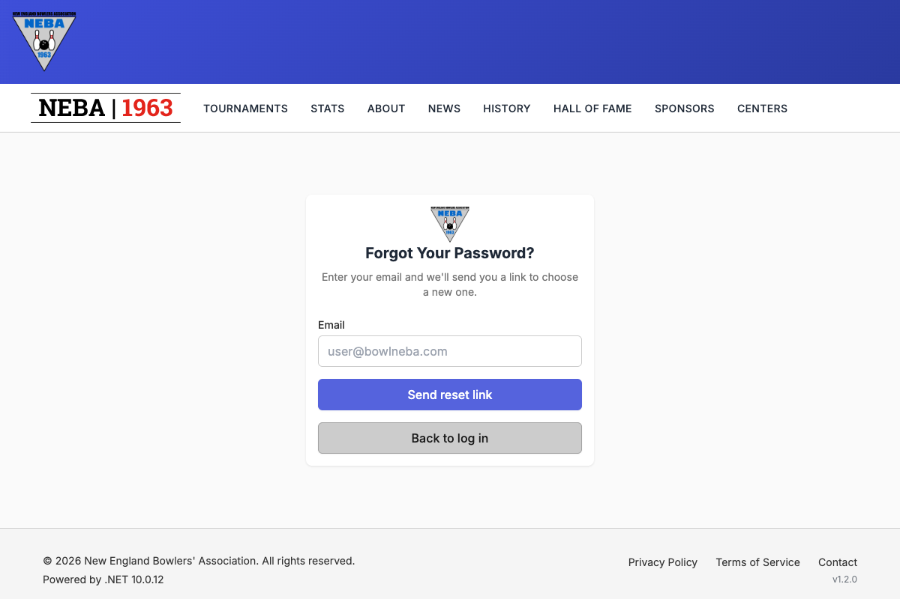
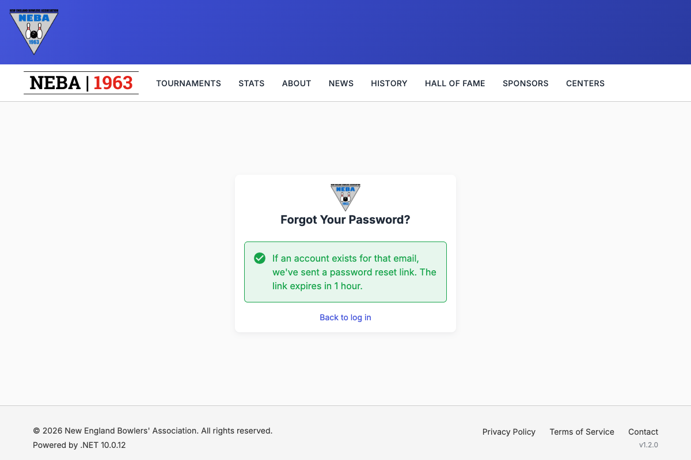
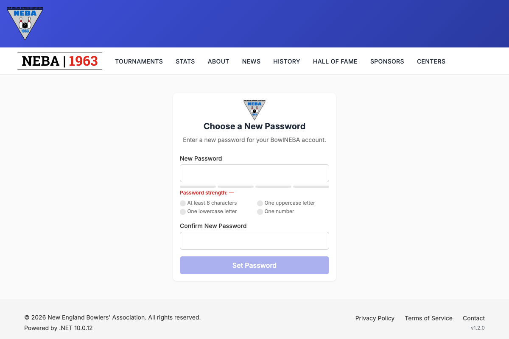

# Reset a Forgotten Password

Lets anyone who can't remember their password get a link by email and choose a new one. No login is needed.

## Prerequisites

None. The page is open to everyone and needs no permission. You need access to the email inbox of your account.

## Steps

1. On the login page, click **Forgot password?** under the password field.

   

2. Enter the email address of your account and click **Send reset link**.

   

3. The page shows the same message every time, whether or not an account exists for that email:

   

   This is on purpose. It stops anyone from using the form to find out which email addresses have accounts.

4. Open the email from BowlNEBA and click **Reset Password**. The link opens the **Choose a New Password** page.

   

5. Type a password into **New Password** and repeat it in **Confirm New Password**. A strength meter and a checklist (at least 8 characters, one uppercase letter, one lowercase letter, one number) update as you type. Click **Set Password**.

You land on the login page with a "Your password has been set" message. Log in with the new password.

## What to know

- **The link works for 1 hour** and only once. After you use it, or after an hour, ask for a new one.
- **You can ask for one new link every 2 minutes** for each account. Asking again sooner sends nothing, and the page still shows the same message.
- **Too many requests from one network** are blocked for a while. If the page says it couldn't send your request, wait a few minutes and try again.
- **No email?** Check your spam folder, check that you typed the address you registered with, and wait a few minutes. If you never had an account, no email is sent.
- **Using the link signs you out everywhere.** Every device that was logged in to the account has to log in again.
- **You get a notice.** After the new password is set, BowlNEBA emails the account a "Your password was changed" notice. If you didn't do it, reset the password again right away and contact website@bowlneba.com.

## API

`POST /security/password/forgot` with a `{ "email": "<address>" }` body. No login is needed.

- **204 No Content**: always returned for a well-formed request, whether or not an account exists. If one does, a reset link is queued.
- **400 Bad Request**: the email is missing, malformed, or longer than 256 characters.
- **429 Too Many Requests**: more than 5 requests from one network in 15 minutes.

The link in the email opens `/account/set-password` with `userId`, `token`, and `reason=reset` in the URL, and the page finishes the job with `POST /security/password/set-from-token`.

## Troubleshooting

| What you see | What it means |
| --- | --- |
| "We couldn't send your request. Please try again in a few minutes." | The request failed (network problem, or too many requests). Wait a few minutes and try again. |
| "Enter a valid email address." | The text isn't shaped like an email address. Fix it and try again. |
| "This reset link is invalid or has expired." (on the Choose a New Password page) | The link is over an hour old, was already used, or the password didn't meet the requirements shown on the page. Click **Request a new link**. |
| The confirmation shows but no email arrives | Either no account exists for that email, or an email went out in the last 2 minutes. Check spam and wait a few minutes. |

## Related

- [Change Your Password](change-password.md): for when you're logged in and know your current password.
- [Reset a User's Password](reset-password.md): the admin action that sends the same kind of link.
- [Create a User](create-user.md): the invite flow uses the same set-password page.
