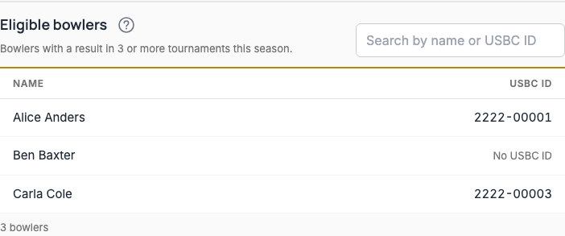
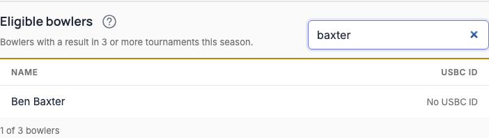

# Invitational Eligibility

Shows who has qualified to bowl an Invitational: the bowlers with a result in 3 or more tournaments of the Invitational's season.

## Prerequisites

None. The page is public: you do not need to sign in. The list shows only on an Invitational that is still scheduled. Completed, truncated and cancelled Invitationals, and other kinds of tournament, do not show it.

## Steps

1. Go to the Invitational's page (`/tournaments/{id}`), from the Tournaments list.
2. Scroll to **Eligible bowlers**. The list shows each bowler's name and USBC ID, sorted by legal last name. A bowler with a nickname is listed by that nickname, so a few names may look out of order. A bowler with no USBC ID on file shows "No USBC ID".

   

3. To find yourself, type part of your name or your USBC ID in the search box. The list narrows as you type, and the line under it shows how many bowlers match.

   

## How eligibility is counted

- Every tournament of the Invitational's season in which you have a recorded result counts once. It does not matter whether the tournament counted toward stats or titles.
- The list grows through the season as results are recorded.
- The list does not show how many tournaments anyone has bowled, or who has not yet qualified.

## Troubleshooting

| What you see | What it means |
| --- | --- |
| You are not on the list | You do not yet have results in 3 tournaments this season, or a recent result is not yet recorded. If you think this is a mistake, email info@bowlneba.com. |
| "No bowlers have reached 3 tournaments yet this season." | Nobody has qualified yet. |
| "No bowlers match" your search | Check the spelling, or try your USBC ID. Accented letters must be typed as they appear. |
| "Could not load the eligible bowlers." | The list failed to load. Click **Try again**. If it keeps failing, email info@bowlneba.com. |

## Related

- [`docs/help/check-team-eligibility.md`](check-team-eligibility.md): checks whether a team may enter a team tournament.
