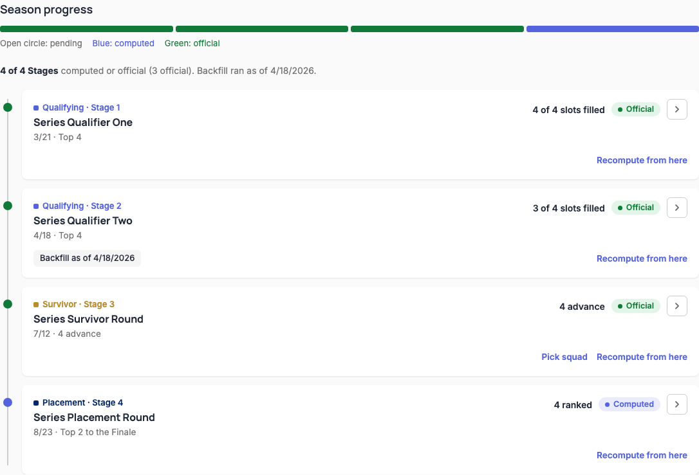
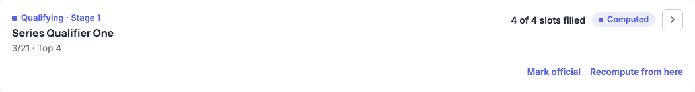
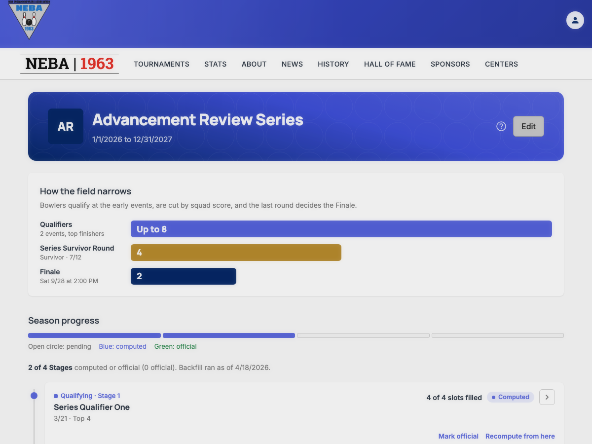
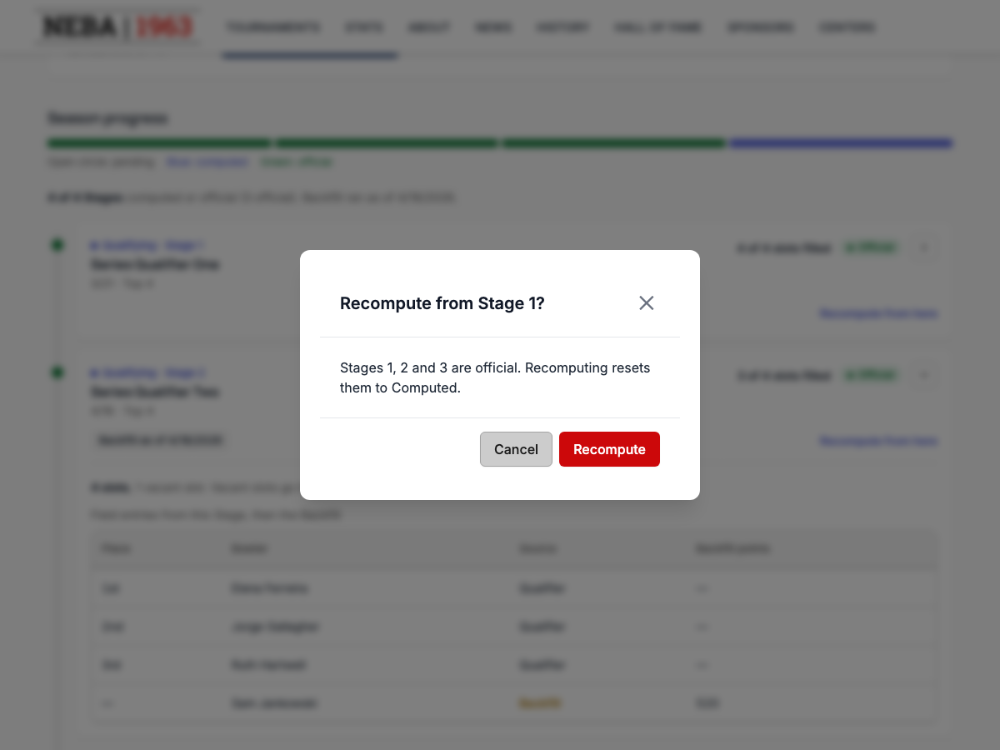
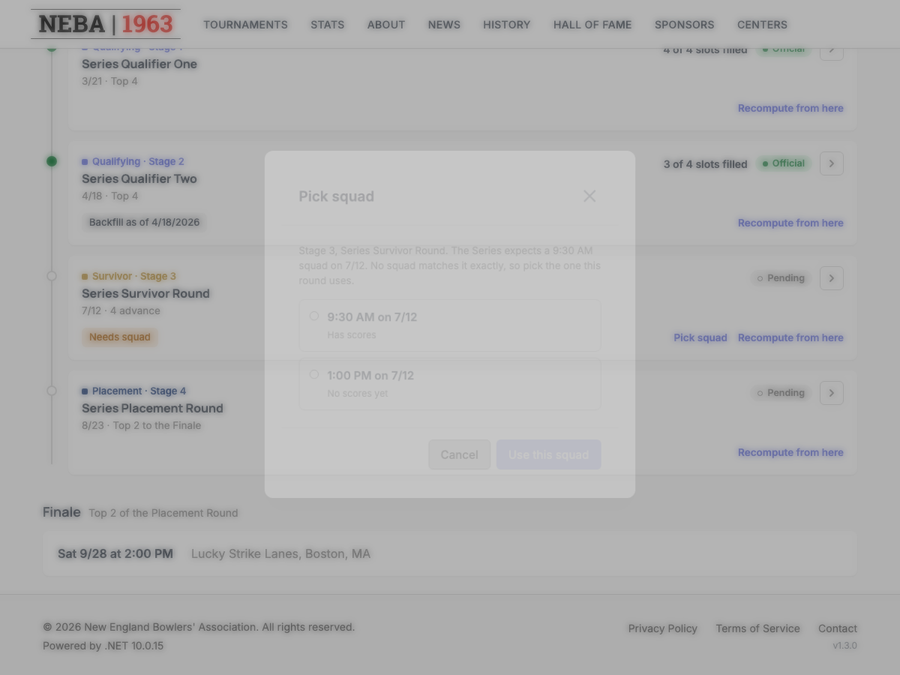
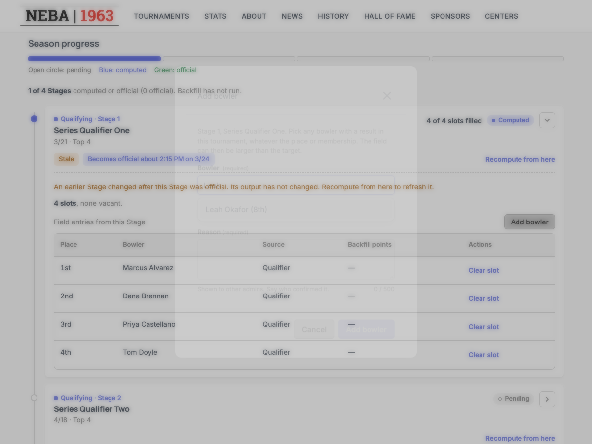
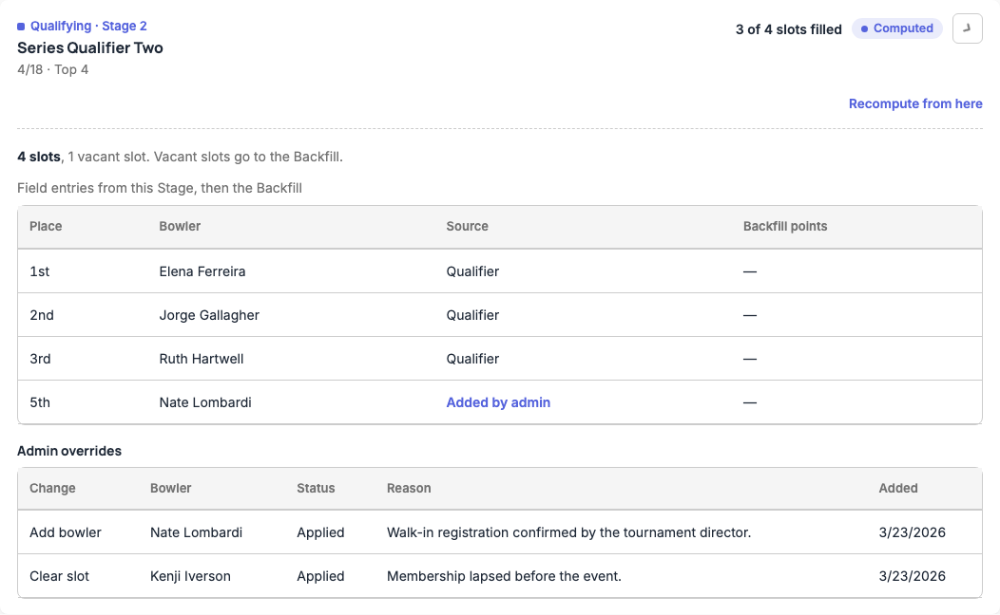

# Series advancement

Shows who advances through each tournament of a Series. Staff review each result, fix the field when it is wrong, and mark the tournament official. Visitors see the names once a tournament is official.

## What it is

A Series is a chain of tournaments. Each tournament has a job: Qualifying, Survivor or Placement. When a tournament in the Series completes, the website works out who advances. You do not enter results by hand.

- **Qualifying.** The top finishers of the tournament take that tournament's slots. A bowler must be a member on the tournament's end date. If a slot goes to a non-member, or to a bowler who already qualified, the slot is vacant.
- **Bowler of the Year point list.** Vacant slots in the last Qualifying tournament go to the next bowlers in Open Bowler of the Year points. A bowler needs more than zero points and must be a member on the point list date. The point list date is the end date of the last Qualifying tournament. The point list is used after the season's stats are generated.
- **Survivor Round.** The Series cuts the field by the score of one squad. Each bowler gets a block total, and the best totals advance.
- **Placement Round.** Bowlers are ranked by their place in the tournament. A bowler who bowled but has no place ranks after those with one. If the Series has a Finale, the top finishers are the finalists.

A tournament in a Series computes only when it is completed (or truncated), it has results, and the tournament before it has computed. Until then it stays Pending.

## Prerequisites

You need the `Series.EditSeries` or the `Series.MakeStageOfficial` permission to see the season rail. Without either, the Series page shows the public view.

| Permission | Who holds it | What it allows |
| --- | --- | --- |
| `Series.EditSeries` | Admin, Webmaster, Manager | See the rail. Pick squad. Recompute. |
| `Series.MakeStageOfficial` | Admin, Webmaster, Manager, Tournament Director | See the rail. Mark a tournament official. |
| `Series.ManageAdvancement` | Admin, Webmaster | Add bowler, Clear slot, Remove override. |

A Tournament Director sees the rail and the **Mark official** button, and nothing that edits the Series.

See [`docs/policies/README.md`](../policies/README.md).

## The season rail

Go to a Series' page (`/series/{id}`). The **Season progress** section lists every tournament in season order. A bar at the top has one segment per tournament. A line under it counts the tournaments done and says whether the point list was used.

Each tournament shows a status:

| Status | What it means |
| --- | --- |
| Pending | The tournament has not computed. |
| Computed | The tournament has a result. It can still change. |
| Official | Staff reviewed the result and marked it official. It changes only when staff run a confirmed Recompute. Visitors see its names. |

A tournament never becomes Official on its own. Someone reviews a Computed tournament, a Placement tournament included, and marks it official (see [Mark a tournament official](#mark-a-tournament-official)). An earlier tournament must be official first. The last Qualifying tournament can become Official only after the point list was used.

### Indicators

A tournament can also show these labels.

| Label | What it means |
| --- | --- |
| Needs squad | A Survivor tournament cannot find its squad. Use **Pick squad**. |
| Stale | An earlier tournament changed after this tournament was official. This tournament's result has not changed. Use **Recompute from here** to refresh it. |
| Bowler of the Year point list as of 4/18/2026 | The point list date. It shows on the last Qualifying tournament. |
| Tournament cancelled: remove it from the Series | The tournament was cancelled. See [Remove a cancelled tournament](#remove-a-cancelled-tournament). |

On a phone, the rail stacks into one column.

## Read a tournament's result

Click the arrow at the right of a tournament to open its result. A Pending tournament says why it has no result.

### Qualifying

- The top line gives the number of slots and how many are vacant.
- **Field entries** lists each bowler, their place, and where the entry came from: **Qualifier**, **Bowler of the Year point list** or **Added by admin**.
- **Bowler of the Year points** shows the Open Bowler of the Year points of each point-list entry.
- **Admin overrides** lists each override with its reason, the date and whether it still applies. An override reads **No longer applies** when it no longer has an effect on the field.

The field can be larger than the number of slots. Ties at the cut all advance, and an added bowler adds one more.

### Survivor Round

A summary line says how many bowlers advance and how many bowled. The table lists each bowler's block total and whether they advanced. **No full block** means the bowler did not bowl a full block.

### Placement Round

A summary line says how many bowlers are ranked. The table lists each position and whether the bowler bowled. If the Series has a Finale, a **Finalist** column shows who is in. Finalist positions are provisional until the Finale is recorded.

## Mark a tournament official

Review a tournament's result first, then mark it official. Visitors see who advanced from a tournament only after you do.

1. Open the tournament with the arrow and check the field. If it is wrong, fix it first (see [Change the Qualifying field](#change-the-qualifying-field-admin-and-webmaster)).
2. Click **Mark official** on the tournament.

3. Read the confirmation and click **Mark official**. A message says "The 2nd tournament is official."

The button shows only on a tournament that is ready:

- The tournament is Computed and not Stale.
- Every earlier tournament is Official. Mark them in order.
- For the last Qualifying tournament, the point list was used.

Marking a tournament official does nothing if it is already official.

If someone finds a mistake after that, an Admin, Webmaster or Manager runs **Recompute from here** on the tournament and confirms. The tournament goes back to Computed and visitors stop seeing its names until it is marked official again.

## What visitors see

A visitor sees every tournament of the Series on its page, grouped by kind. The public page calls a tournament by its place in the season: **1st tournament**, **2nd tournament**, and so on. Each tournament is a card that opens and closes. An Official tournament starts open, with its results. A tournament that is not yet official has no results and no expander.

- **Qualifying.** Each bowler with their place. Bowlers who took a vacant slot show **Bowler of the Year point list** and their points, highest first, then by last name and first name. A bowler who already advanced from an earlier tournament keeps their place, dimmed, with **Advanced in 1st tournament** (or the matching tournament).
- **Survivor Round.** The full standings by block total, in a scrollable box. A column says who advanced, and a dashed line marks the cut.
- **Placement Round.** Every position, in a scrollable box, with the bowler's tournament place and whether they bowled. When the Series has a Finale, a column marks the finalists and a dashed line marks the cut.

The results have no status labels, no override reasons and no buttons.

## Recompute from a tournament

Use **Recompute from here** to rebuild a tournament and every tournament after it. Use it after you fix a tournament's data, or to catch up a tournament that completed before this feature went live.

1. Click **Recompute from here** on the tournament.
2. If no Official tournament comes after it, the Recompute runs at once. A message says "Recomputed from the Nth tournament."
3. If Official tournaments come after it, a confirmation lists them and says they reset to Computed. Click **Recompute** to go on or **Cancel** to stop.

Overrides stay through every Recompute.

## Pick a squad for a Survivor tournament

A Survivor tournament needs one squad. The website matches the squad by the date and start time the Series expects. When no squad matches, the tournament shows **Needs squad** and waits.

1. Click **Pick squad** on the Survivor tournament.
2. Choose a squad. The list shows each squad's time and whether it has scores.
3. Click **Use this squad**. A message says "Squad saved."

The tournament computes once the squad has scores. You can also pick a squad on an Official Survivor tournament. That can mark the tournament Stale. It does not change the result.

## Change the Qualifying field (Admin and Webmaster)

Overrides apply to Qualifying tournaments only. They work while the tournament is Computed. An Official tournament rejects them: run a confirmed Recompute first.

Every override needs a reason. The reason can be up to 500 characters, and other admins can read it. An override lasts through every Recompute until someone removes it.

### Add a bowler

Use this to put a bowler in the field who did not qualify by place.

1. Open the tournament and click **Add bowler**.
2. Pick a bowler. The list holds bowlers with a result in this tournament, whatever their place or membership. Bowlers already in the field are not listed.
3. Type a reason.
4. Click **Add bowler**.

The field can now be larger than the number of slots. An added bowler does not fill a vacant slot.

### Clear a slot

Use this to take a bowler out of a slot. The slot goes vacant and the Bowler of the Year point list refills it. That bowler cannot return through the Bowler of the Year point list.

1. Open the tournament and click **Clear slot** on the bowler's row. Only bowlers who qualified by place have this link.
2. Type a reason and confirm.

### Remove an override

1. Open the tournament and click **Remove override** on the override's row.
2. Confirm in "Remove this override?".

Removing an Add takes the bowler out of the field. Removing a Clear gives the bowler the slot back, and the Bowler of the Year point list no longer refills it.

### What a Manager sees

A Manager sees the same results and the same override list. The **Add bowler**, **Clear slot** and **Remove override** controls do not appear.

## Remove a cancelled tournament

A Series locks once any tournament leaves Pending. A locked Series normally keeps its tournaments. One exception: you can remove a Pending tournament that was cancelled.

1. On the Series page, find the tournament that says **Tournament cancelled: remove it from the Series**. Follow the link to the Edit Series page, or click **Edit**.
2. On the Edit Series page, click the remove button on that tournament's row. Only that row has one.
3. Click **Save changes**.
4. Back on the Series page, click **Recompute from here** on the tournament before the removed one. The target field shrinks.

If the page cannot check for cancelled tournaments, it shows a warning and removes nothing. Reload the page to try again.

## What happens when two people change a Series

If someone else changed the Series after you opened the page, your change does not save. You see a "Series Changed" message. The page reloads with the latest data. Check it and try again.

## Who can do what

| Action | Admin | Webmaster | Manager | Tournament Director |
| --- | --- | --- | --- | --- |
| See tournament status and results | Yes | Yes | Yes | Yes |
| Mark a tournament official | Yes | Yes | Yes | Yes |
| Pick squad | Yes | Yes | Yes | No |
| Recompute from a tournament | Yes | Yes | Yes | No |
| Remove a cancelled tournament (Edit Series) | Yes | Yes | Yes | No |
| Add bowler, Clear slot, Remove override | Yes | Yes | No | No |

## If something looks wrong

| What you see | What to do |
| --- | --- |
| A Survivor tournament says **Needs squad** | Click **Pick squad** and choose the squad the round used. |
| A tournament says **Stale** | An earlier tournament changed. Click **Recompute from here** on that tournament. |
| A tournament is Pending after it completed | The tournament waits for the tournament before it, for results, or for a squad. Check the tournament before it first. |
| A tournament completed before this feature went live | It was not picked up. Click **Recompute from here** on the first tournament. |
| "Tournament status could not load" | Click **Retry**. |
| "The tournament status could not refresh" | Reload the page. |
| A tournament shows **Tournament cancelled: remove it from the Series** | See [Remove a cancelled tournament](#remove-a-cancelled-tournament). |
| You cannot add an override to a tournament | The tournament may be Official, or not a Qualifying tournament. Run a confirmed Recompute to reset an Official tournament. |
| No Season progress section | You hold neither `Series.EditSeries` nor `Series.MakeStageOfficial`. |
| A tournament has no **Mark official** button | The tournament may be Pending, Stale or Official, an earlier tournament may not be official yet, or the Bowler of the Year point list may not have run. You may also lack `Series.MakeStageOfficial`. |
| Visitors do not see a tournament's names | The tournament is not official yet. Review it and click **Mark official**. |
| You found a mistake in an Official tournament | Run a confirmed **Recompute from here**, fix the field, then mark the tournament official again. |

## Related

- [`edit-series.md`](edit-series.md): change a Series' name, logo, tournaments and Finale.
- [`create-series.md`](create-series.md): set up a Series.
- [`docs/policies/README.md`](../policies/README.md): the `Series.EditSeries` and `Series.ManageAdvancement` policies.
