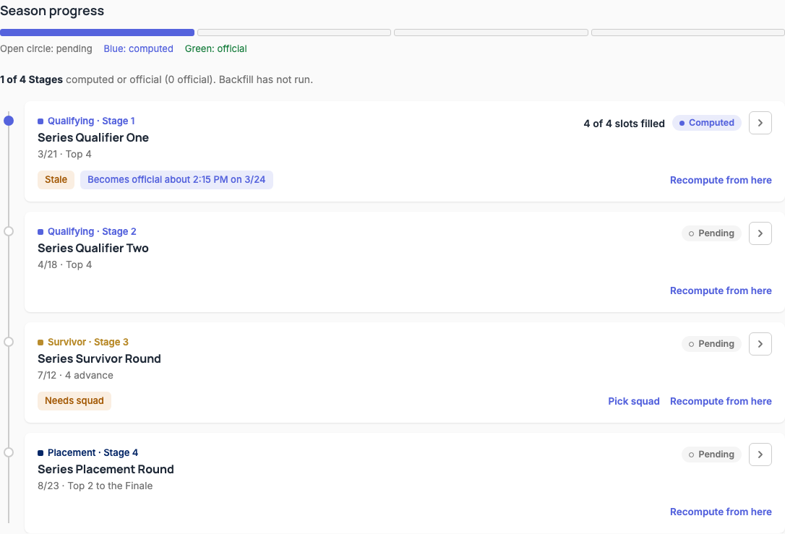
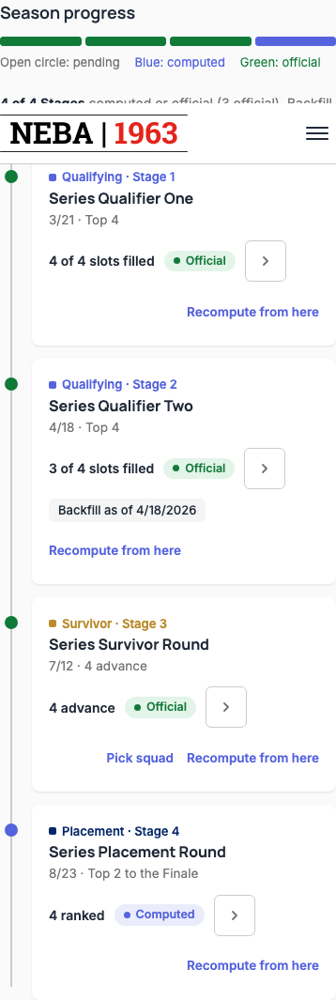
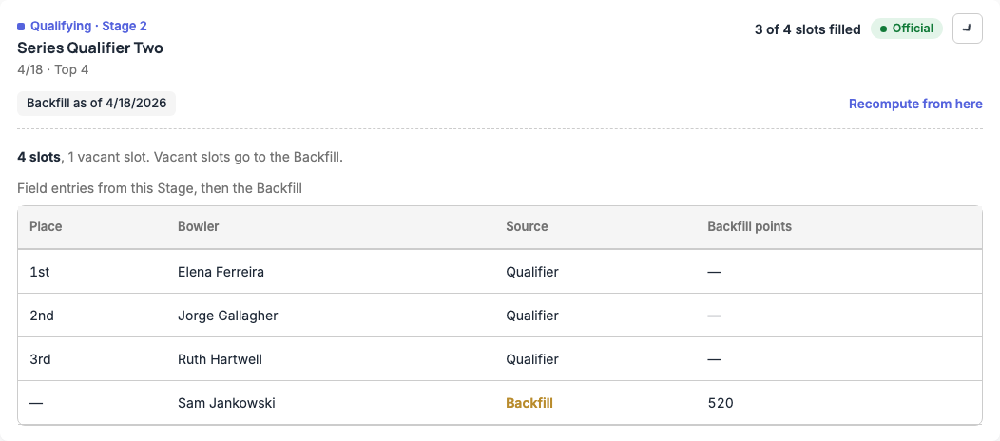
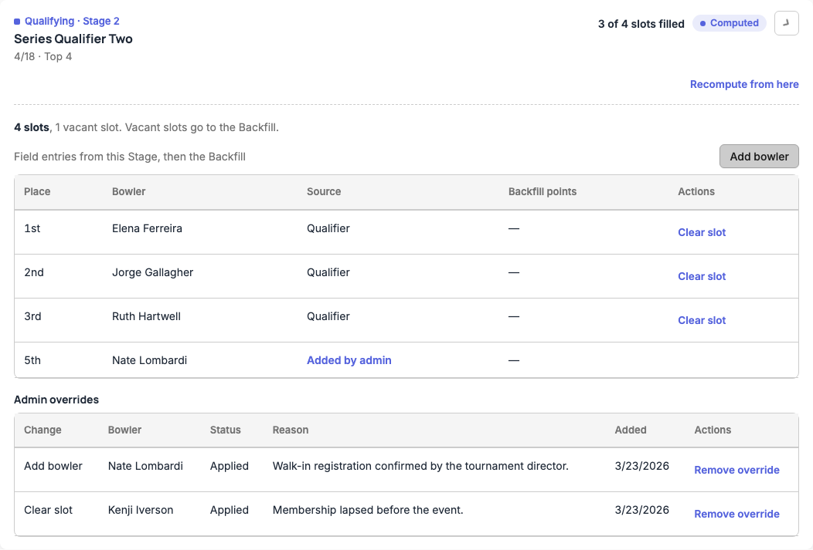
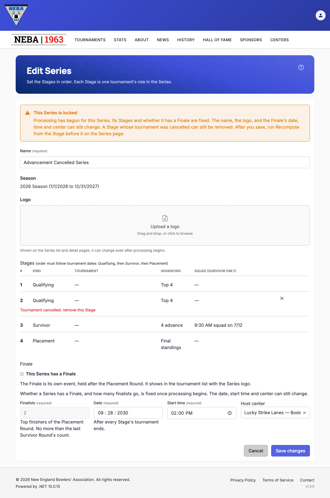

# Series advancement

Shows who advances through each Stage of a Series, and lets staff fix the field when the automatic result is wrong.

## What it is

A Series is a chain of Stages. Each Stage is one tournament with a job: Qualifying, Survivor or Placement. When a tournament linked to a Stage completes, the website works out who advances. You do not enter results by hand.

- **Qualifying.** The top finishers of the tournament take the Stage's slots. A bowler must be a member on the tournament's end date. If a slot goes to a non-member, or to a bowler who already qualified, the slot is vacant.
- **Backfill.** Vacant slots in the last Qualifying Stage go to the next bowlers in Open Bowler of the Year points. A bowler needs more than zero points and must be a member on the Backfill date. The Backfill date is the end date of the last Qualifying tournament. The Backfill runs after the season's stats are generated.
- **Survivor Round.** The Series cuts the field by the score of one squad. Each bowler gets a block total, and the best totals advance.
- **Placement Round.** Bowlers are ranked by their place in the tournament. If the Series has a Finale, the top finishers are the finalists.

A Stage computes only when its tournament is completed (or truncated), it has results, and the Stage before it has computed. Until then it stays Pending.

## Prerequisites

You need the `Series.EditSeries` permission to see Series advancement. Admin, Webmaster and Manager hold it. Without it, the Series page shows no advancement section.

Adding a bowler, clearing a slot and removing an override also need the `Series.ManageAdvancement` permission. Admin and Webmaster hold it. Manager does not. See [`docs/policies/README.md`](../policies/README.md).

## The season rail

Go to a Series' page (`/series/{id}`). The **Season progress** section lists every Stage in season order. A bar at the top has one segment per Stage. A line under it counts the Stages done and says whether the Backfill ran.

Each Stage shows a status:

| Status | What it means |
| --- | --- |
| Pending | The Stage has not computed. |
| Computed | The Stage has a result. It can still change. |
| Official | The result is settled. It changes only when staff run a confirmed Recompute. |

A Placement Stage is Pending or Computed. It is never Official.

A Computed Qualifying or Survivor Stage becomes Official on its own after 24 hours, if nothing changes it. An earlier Stage must be official first. The last Qualifying Stage becomes Official only after the Backfill ran.

### Indicators

A Stage can also show these labels.

| Label | What it means |
| --- | --- |
| Needs squad | A Survivor Stage cannot find its squad. Use **Pick squad**. |
| Stale | An earlier Stage changed after this Stage was official. This Stage's result has not changed. Use **Recompute from here** to refresh it. |
| Becomes official about 2:15 PM on 3/24 | The time the Stage turns Official if nothing changes it. |
| Backfill as of 4/18/2026 | The Backfill date. It shows on the last Qualifying Stage. |
| Tournament cancelled: remove this Stage | The Stage's tournament was cancelled. See [Remove a cancelled Stage](#remove-a-cancelled-stage). |

On a phone, the rail stacks into one column.

## Read a Stage's result

Click the arrow at the right of a Stage to open its result. A Pending Stage says why it has no result.

### Qualifying

- The top line gives the number of slots and how many are vacant.
- **Field entries** lists each bowler, their place, and where the entry came from: **Qualifier**, **Backfill** or **Added by admin**.
- **Backfill points** shows the Open Bowler of the Year points of each Backfill entry.
- **Admin overrides** lists each override with its reason, the date and whether it still applies. An override reads **No longer applies** when it no longer has an effect on the field.

The field can be larger than the number of slots. Ties at the cut all advance, and an added bowler adds one more.

### Survivor Round

A summary line says how many bowlers advance and how many bowled. The table lists each bowler's block total and whether they advanced. **No full block** means the bowler did not bowl a full block.

### Placement Round

A summary line says how many bowlers are ranked. The table lists each position and whether the bowler bowled. If the Series has a Finale, a **Finalist** column shows who is in. Finalist positions are provisional until the Finale is recorded.

## Recompute from a Stage

Use **Recompute from here** to rebuild a Stage and every Stage after it. Use it after you fix a tournament's data, or to catch up a tournament that completed before this feature went live.

1. Click **Recompute from here** on the Stage.
2. If no Official Stage comes after it, the Recompute runs at once. A message says "Recomputed from Stage N."
3. If Official Stages come after it, a confirmation lists them and says they reset to Computed. Click **Recompute** to go on or **Cancel** to stop.

Overrides stay through every Recompute.

## Pick a squad for a Survivor Stage

A Survivor Stage needs one squad. The website matches the squad by the date and start time the Series expects. When no squad matches, the Stage shows **Needs squad** and waits.

1. Click **Pick squad** on the Survivor Stage.
2. Choose a squad. The list shows each squad's time and whether it has scores.
3. Click **Use this squad**. A message says "Squad saved."

The Stage computes once the squad has scores. You can also pick a squad on an Official Survivor Stage. That can mark the Stage Stale. It does not change the result.

## Change the Qualifying field (Admin and Webmaster)

Overrides apply to Qualifying Stages only. They work while the Stage is Computed. An Official Stage rejects them: run a confirmed Recompute first.

Every override needs a reason. The reason can be up to 500 characters, and other admins can read it. An override lasts through every Recompute until someone removes it.

### Add a bowler

Use this to put a bowler in the field who did not qualify by place.

1. Open the Stage and click **Add bowler**.
2. Pick a bowler. The list holds bowlers with a result in this Stage's tournament, whatever their place or membership. Bowlers already in the field are not listed.
3. Type a reason.
4. Click **Add bowler**.

The field can now be larger than the number of slots. An added bowler does not fill a vacant slot.

### Clear a slot

Use this to take a bowler out of a slot. The slot goes vacant and the Backfill refills it. That bowler cannot return through the Backfill.

1. Open the Stage and click **Clear slot** on the bowler's row. Only bowlers who qualified by place have this link.
2. Type a reason and confirm.

### Remove an override

1. Open the Stage and click **Remove override** on the override's row.
2. Confirm in "Remove this override?".

Removing an Add takes the bowler out of the field. Removing a Clear gives the bowler the slot back, and the Backfill no longer refills it.

### What a Manager sees

A Manager sees the same results and the same override list. The **Add bowler**, **Clear slot** and **Remove override** controls do not appear.

## Remove a cancelled Stage

A Series locks once any Stage leaves Pending. A locked Series normally keeps its Stages. One exception: you can remove a Pending Stage whose tournament was cancelled.

1. On the Series page, find the Stage that says **Tournament cancelled: remove this Stage**. Follow the link to the Edit Series page, or click **Edit**.
2. On the Edit Series page, click the remove button on that Stage's row. Only that row has one.
3. Click **Save changes**.
4. Back on the Series page, click **Recompute from here** on the Stage before the removed one. The target field shrinks.

If the page cannot check for cancelled tournaments, it shows a warning and removes nothing. Reload the page to try again.

## What happens when two people change a Series

If someone else changed the Series after you opened the page, your change does not save. You see a "Series Changed" message. The page reloads with the latest data. Check it and try again.

## Who can do what

| Action | Admin | Webmaster | Manager |
| --- | --- | --- | --- |
| See Stage status and results | Yes | Yes | Yes |
| Pick squad | Yes | Yes | Yes |
| Recompute from a Stage | Yes | Yes | Yes |
| Remove a cancelled Stage (Edit Series) | Yes | Yes | Yes |
| Add bowler, Clear slot, Remove override | Yes | Yes | No |

## If something looks wrong

| What you see | What to do |
| --- | --- |
| A Survivor Stage says **Needs squad** | Click **Pick squad** and choose the squad the round used. |
| A Stage says **Stale** | An earlier Stage changed. Click **Recompute from here** on that Stage. |
| A Stage is Pending after its tournament completed | The Stage waits for the Stage before it, for results, or for a squad. Check the Stage before it first. |
| A tournament completed before this feature went live | It was not picked up. Click **Recompute from here** on the first Stage. |
| "Stage status could not load" | Click **Retry**. |
| "The Stage status could not refresh" | Reload the page. |
| A Stage shows **Tournament cancelled: remove this Stage** | See [Remove a cancelled Stage](#remove-a-cancelled-stage). |
| You cannot add an override to a Stage | The Stage may be Official, or not a Qualifying Stage. Run a confirmed Recompute to reset an Official Stage. |
| No Season progress section | You do not hold `Series.EditSeries`. |

## Related

- [`edit-series.md`](edit-series.md): change a Series' name, logo, Stages and Finale.
- [`create-series.md`](create-series.md): set up a Series.
- [`docs/policies/README.md`](../policies/README.md): the `Series.EditSeries` and `Series.ManageAdvancement` policies.
